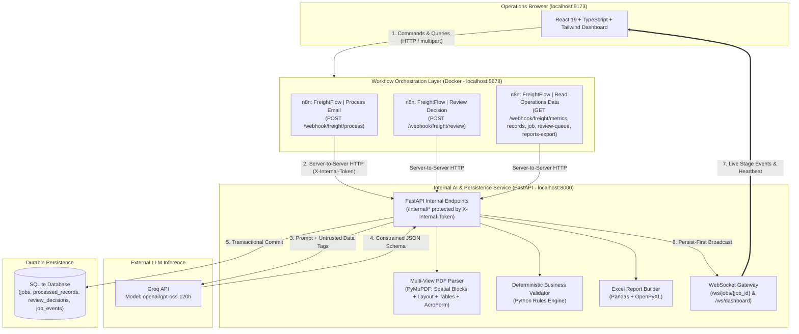
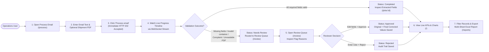
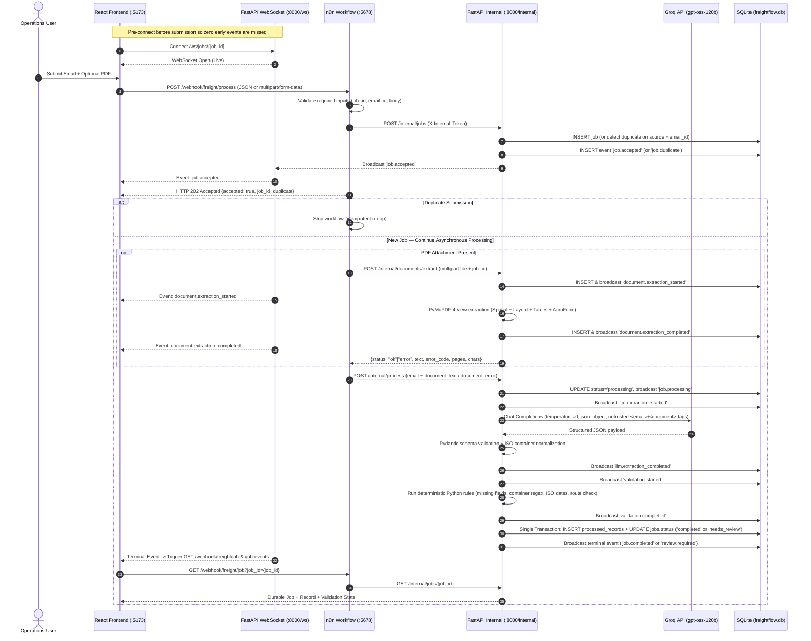
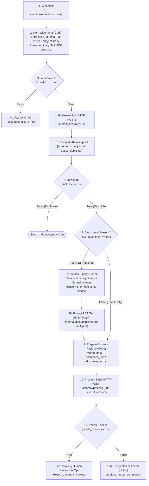
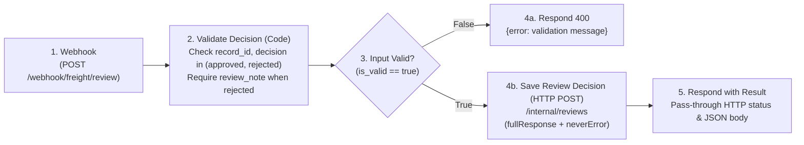
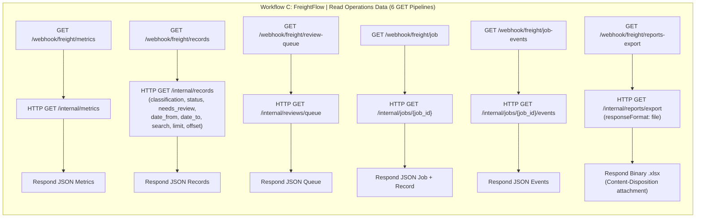

# FreightFlow AI — Intelligent Freight Email & Shipping Document Automation

> **Portfolio Demonstration Project** | AI-Assisted Logistics & Freight-Forwarding Operations Workflow  
> **Core Stack:** React + TypeScript · n8n (Docker) · FastAPI (Python) · PyMuPDF · Groq (`openai/gpt-oss-120b`) · SQLite · WebSockets

---

## 1. Project Objective

Freight forwarding and logistics operations desks receive hundreds of daily emails containing unstructured shipment requests and multi-column PDF attachments (Bills of Lading, Sea Waybills, Booking Confirmations, Commercial Invoices, and Packing Lists). Manually triaging each email, reading complex PDF grids, keying shipment fields into internal spreadsheets/systems, and chasing missing information consumes significant operational time and introduces manual data-entry errors.

**FreightFlow AI** automates the repetitive first stage of freight operations while enforcing strict **human-in-the-loop (HITL)** safety controls:

1. **Ingest:** Accepts freight emails and optional PDF shipping documents (`multipart/form-data` or JSON) through **n8n** webhooks.
2. **Multi-View PDF Extraction:** Extracts layout-preserving text from digital PDFs using a 4-view **PyMuPDF** pipeline (spatial `[x,y]` coordinate blocks, reading-order layout text, Markdown tables via `find_tables()`, and interactive AcroForm fields) while detecting scanned/unreadable documents.
3. **LLM Classification & Structured Extraction:** Uses **Groq (`openai/gpt-oss-120b`)** to classify each request into one of 6 logistics categories (`booking_request`, `tracking_request`, `quotation_request`, `documentation_request`, `complaint`, `other`) and extract 10 schema-validated fields without hallucinating missing data.
4. **Deterministic Validation:** Runs Python business rules to check required category fields, ISO container number format (`4 letters + 7 digits`), ISO dates (`YYYY-MM-DD`), route consistency, and document readability.
5. **Human-in-the-Loop Review Queue:** Routes incomplete, ambiguous, or high-risk (`complaint` / `other` / unreadable PDF) records to an interactive review queue where an operator can inspect flag reasons, edit fields, and **Approve** or **Reject** with audit notes.
6. **Real-Time Observability & Reporting:** Streams live stage-by-stage progress over **FastAPI WebSockets** to the React operations dashboard and exports filtered multi-tab **Excel (`.xlsx`)** operational reports.

> **Safety Boundary:** By design, FreightFlow AI never automatically confirms bookings with carriers, quotes freight rates, alters external TMS records, or sends customer-facing replies. All external actions remain under human control.

---

## 2. Detailed Architecture Diagrams (User Flow vs. System Flow)

### 2.1 High-Level Component Architecture



---

### 2.2 User Flow (Operations Staff Experience)



---

### 2.3 System Flow (Asynchronous Execution, Idempotency & WebSocket Sequence)



---

## 3. n8n Workflow Logic & Node-by-Node Design

All three n8n workflows are version-controlled as JSON files in `n8n/workflows/` and mounted read-only into the `freightflow-n8n` Docker container at `/workflows` via `docker-compose.yml`. Every internal HTTP call from n8n to FastAPI uses the container environment variables:
- `FASTAPI_BASE_URL` (`http://host.docker.internal:8000`)
- `INTERNAL_API_TOKEN` (sent in the `X-Internal-Token` header)

---

### 3.1 Workflow A — `FreightFlow | Process Email` (`n8n/workflows/freight_process_email.json`)

- **Workflow ID:** `freightflowprocess01`
- **Webhook Entry Point:** `POST /webhook/freight/process` (accepts both `application/json` and `multipart/form-data` with binary `file`)
- **Core Responsibility:** Validate incoming email payload, register the job idempotently, **immediately return `HTTP 202 Accepted` to the browser before running heavy PDF/LLM steps**, extract PDF text if attached, invoke LLM + deterministic validation, and branch on `needs_review`.



#### Key Engineering Details in Workflow A:
1. **Immediate Non-Blocking `202 Accepted` (`Respond 202`):** The webhook uses `responseMode: "responseNode"`. As soon as FastAPI creates (or deduplicates) the job in SQLite (`POST /internal/jobs`), n8n responds `202 Accepted` to the React client and continues executing the downstream PDF extraction and Groq LLM nodes asynchronously.
2. **Binary Attachment Preservation (`Attach Binary` Code Node):** In n8n, making an intermediate JSON HTTP request (`Create Job`) drops the incoming `binary.file` stream from the current item. The `Attach Binary` node restores `$('Normalise Input').first().binary` before sending the `multipart/form-data` request to `POST /internal/documents/extract`.
3. **Graceful PDF Error Forwarding (`Prepare Process Payload` Code Node):** Even if `POST /internal/documents/extract` flags an unreadable/scanned/empty PDF (`status: "error"`, `error_code: "SCANNED_OR_UNREADABLE_PDF"`), the workflow does not crash; it forwards `document_error` into `POST /internal/process` so the email body is still classified and the record is deterministically routed to `needs_review` with `document_error`.

---

### 3.2 Workflow B — `FreightFlow | Review Decision` (`n8n/workflows/freight_review_decision.json`)

- **Workflow ID:** `freightflowreview01`
- **Webhook Entry Point:** `POST /webhook/freight/review`
- **Core Responsibility:** Validate human reviewer decisions (`approved` with optional field overrides, or `rejected` with a mandatory `review_note`) and persist the audit decision via FastAPI.



#### Key Engineering Details in Workflow B:
- **Pre-Flight Reviewer Validation (`Validate Decision`):** Rejects malformed requests (`HTTP 400`) before hitting FastAPI if `record_id` is missing, `decision` is not `approved`/`rejected`, or `decision === "rejected"` without a non-empty `review_note`.
- **Transparent Status Code Forwarding (`Save Review Decision` + `Respond with Result`):** Configured with `fullResponse: true` and `neverError: true` so that if FastAPI returns `422 Unprocessable Entity` (e.g., an operator edits a container number to an invalid format during approval), n8n forwards the exact `422` status and error detail back to the React review form.

---

### 3.3 Workflow C — `FreightFlow | Read Operations Data` (`n8n/workflows/freight_read_operations_data.json`)

- **Workflow ID:** `freightflowread01`
- **Core Responsibility:** Contains **6 independent `GET` webhook pipelines** in a single workflow so the React frontend reads all operational state and downloads Excel reports exclusively through n8n.



| Webhook Path | Target FastAPI Internal Endpoint | Response Type | Purpose |
|---|---|---|---|
| `GET /webhook/freight/metrics` | `GET /internal/metrics` | `JSON` | Dashboard KPI cards, classification chart, and review queue count |
| `GET /webhook/freight/records` | `GET /internal/records` | `JSON` | Paginated & filtered processed records (with reviewer corrections merged) |
| `GET /webhook/freight/review-queue` | `GET /internal/reviews/queue` | `JSON` | Pending `needs_review` records for `/review` |
| `GET /webhook/freight/job` | `GET /internal/jobs/{job_id}` | `JSON` | Full durable job state, extracted fields, and validation flags for `/jobs/:jobId` |
| `GET /webhook/freight/job-events` | `GET /internal/jobs/{job_id}/events` | `JSON` | Ordered stage timeline events for `/jobs/:jobId` |
| `GET /webhook/freight/reports-export` | `GET /internal/reports/export` | `Binary (.xlsx)` | Streams multi-sheet Excel workbook directly to the browser download |

---

### 3.4 How to Inspect or Modify Workflows in n8n

1. Open **`http://localhost:5678`** in your browser to view the 3 workflows visually on the n8n canvas.
2. If you edit any JSON file in `n8n/workflows/`, re-import and re-publish it into the running container:
   ```powershell
   docker exec freightflow-n8n n8n import:workflow --separate --input=/workflows
   docker exec freightflow-n8n n8n publish:workflow --id=freightflowprocess01
   docker exec freightflow-n8n n8n publish:workflow --id=freightflowreview01
   docker exec freightflow-n8n n8n publish:workflow --id=freightflowread01
   docker restart freightflow-n8n
   ```
3. Conversely, if you edit a workflow inside the n8n visual editor and want to save it back to git:
   ```powershell
   docker exec freightflow-n8n n8n export:workflow --id=freightflowprocess01 --output=/tmp/freight_process_email.json
   docker cp freightflow-n8n:/tmp/freight_process_email.json n8n/workflows/freight_process_email.json
   ```

---

## 4. Tool & Technology Stack

| Layer | Technology | Role in FreightFlow AI |
|---|---|---|
| **Frontend UI** | React 19, TypeScript, Vite 8 | SPA operations interface with 6 routes (`/`, `/process`, `/jobs/:jobId`, `/review`, `/reports`, `/settings`) |
| **Styling & Icons** | Tailwind CSS v4, Lucide React | Responsive layout, status badges (`Completed`, `Needs review`, `Approved`, `Rejected`, `Failed`), icons |
| **Data Visualization** | Recharts | Classification breakdown bar chart on the Dashboard |
| **Workflow Backend** | n8n (Docker) | Public webhook entry points, input validation, HTTP 202 acknowledgement, binary PDF routing, retry orchestration |
| **Internal AI Service** | Python 3.11+, FastAPI, Uvicorn | Protected `/internal/*` REST APIs, LLM orchestration, PDF extraction, deterministic validation, WebSocket gateway |
| **LLM Inference** | Groq API (`openai/gpt-oss-120b`) | Zero-temperature classification and structured JSON extraction with prompt-injection isolation |
| **PDF Processing** | PyMuPDF (`pymupdf`) | Magic-byte signature check, size/page limits, 4-view layout-aware text/table/AcroForm extraction |
| **Database** | SQLite (`sqlite3` with WAL/FKs) | Durable storage for `jobs`, `processed_records`, `review_decisions`, and `job_events` |
| **Reporting** | Pandas, OpenPyXL | Multi-sheet `.xlsx` export (`Processed_Emails`, `Human_Review_Queue`, `Report_Metadata`) |
| **Testing** | Pytest, HTTPX, Vitest | 49 backend unit/integration/dataset tests + 5 frontend service/contract tests |

---

## 5. Repository Structure

```text
FreightFlow-AI/
├── backend/
│   ├── app/
│   │   ├── main.py              # FastAPI app, /internal/* endpoints & /ws/* WebSocket routes
│   │   ├── config.py            # Environment settings (Groq model, DB path, PDF caps, CORS)
│   │   ├── schemas.py           # Pydantic schemas & container number normalization
│   │   ├── llm_service.py       # Groq client, untrusted data wrapping & JSON validation
│   │   ├── pdf_parser.py        # 4-view PyMuPDF extractor (Spatial blocks, Layout, Tables, Widgets)
│   │   ├── validator.py         # Deterministic Python business validation rules
│   │   ├── job_service.py       # Idempotent job lifecycle, review decisions, metrics & queries
│   │   ├── report_service.py    # Multi-tab Excel (.xlsx) generator via Pandas + OpenPyXL
│   │   ├── realtime.py          # Thread-safe WebSocket connection manager
│   │   └── database.py          # SQLite schema & transactional connection context manager
│   ├── tests/                   # 49 Pytest unit, API, PDF, endpoint & dataset tests
│   ├── evaluate_dataset.py      # Offline & live Groq evaluation runner for the 32 sample emails
│   ├── requirements.txt
│   └── .env.example
├── frontend/
│   ├── src/
│   │   ├── components/          # Layout, Dashboard cards/charts, Job timeline/fields, Review form
│   │   ├── hooks/               # Reconnecting WebSocket hooks (job stream & dashboard feed)
│   │   ├── pages/               # Dashboard, ProcessEmail, JobDetails, ReviewQueue, Reports, Settings
│   │   ├── services/            # n8nClient.ts (HTTP/multipart client) + Vitest unit tests
│   │   └── types/               # TypeScript contracts for jobs, records, metrics, and events
│   ├── package.json
│   ├── vite.config.ts
│   └── .env.example
├── n8n/
│   └── workflows/
│       ├── freight_process_email.json         # Workflow A: Webhook -> 202 -> PDF -> Process -> Branch
│       ├── freight_review_decision.json       # Workflow B: Reviewer Approve/Reject + Corrections
│       └── freight_read_operations_data.json  # Workflow C: Metrics, Records, Queue, Job, Excel Export
├── samples/
│   ├── documents/               # Sample digital, AcroForm, multi-box B/L, scanned & empty PDFs
│   └── emails/                  # 32 labelled synthetic emails + live Groq evaluation results
├── docker-compose.yml           # Local n8n container with persistent volume & host.docker.internal
└── README.md
```

---

## 6. How to Set Up and Run the Project

### Prerequisites
- **Python 3.11+** (`python --version`)
- **Node.js 20+ and npm** (`node --version`)
- **Docker Desktop** (with `docker compose` available)
- **Groq API Key** (from [console.groq.com](https://console.groq.com))

---

### Step 1 — Configure Environment Variables

1. **Backend (`backend/.env`):**  
   Copy `backend/.env.example` to `backend/.env` and set your Groq API key and internal token:
   ```powershell
   Copy-Item backend\.env.example backend\.env
   ```
   Edit `backend/.env`:
   ```env
   GROQ_API_KEY=your_groq_api_key_here
   GROQ_MODEL=openai/gpt-oss-120b
   DATABASE_PATH=data/freightflow.db
   INTERNAL_API_TOKEN=dev-internal-token-change-me
   ALLOWED_ORIGINS=http://localhost:5173
   ```
   *( Note: `INTERNAL_API_TOKEN` must match the token passed to n8n in `docker-compose.yml`, which defaults to `dev-internal-token-change-me` in local development. )*

2. **Frontend (`frontend/.env`):**  
   Copy `frontend/.env.example` to `frontend/.env`:
   ```powershell
   Copy-Item frontend\.env.example frontend\.env
   ```
   Contents of `frontend/.env`:
   ```env
   VITE_N8N_BASE_URL=http://localhost:5678
   VITE_WS_URL=ws://localhost:8000
   ```

---

### Step 2 — Set Up & Run the Backend (FastAPI)

Open a PowerShell terminal in the project root (`d:\Projects\Frieght Pipeline`):

```powershell
# 1. Create and activate the Python virtual environment (first time only)
python -m venv backend\.venv

# 2. Install Python dependencies (first time only)
backend\.venv\Scripts\python.exe -m pip install -r backend\requirements.txt

# 3. Start the FastAPI server on port 8000 (keep this terminal running)
cd backend
.\.venv\Scripts\python.exe -m uvicorn app.main:app --reload --host 0.0.0.0 --port 8000
```

- FastAPI health check: `http://localhost:8000/health` → `{"status":"ok"}`

---

### Step 3 — Start n8n (Docker) & Publish Workflows

Open a **second** PowerShell terminal in the project root (`d:\Projects\Frieght Pipeline`):

```powershell
# 1. Start the n8n container in the background
docker compose up -d

# 2. Wait ~20 seconds on first start for n8n database initialization, then import the 3 workflows
docker exec freightflow-n8n n8n import:workflow --separate --input=/workflows

# 3. Publish (activate) all 3 workflows and restart n8n so webhook registrations take effect
docker exec freightflow-n8n n8n publish:workflow --id=freightflowprocess01
docker exec freightflow-n8n n8n publish:workflow --id=freightflowreview01
docker exec freightflow-n8n n8n publish:workflow --id=freightflowread01
docker restart freightflow-n8n
```

- n8n Editor UI: `http://localhost:5678`
- Active Webhook Base URL: `http://localhost:5678/webhook/freight/*`

---

### Step 4 — Set Up & Run the Frontend (React + Vite)

Open a **third** PowerShell terminal in the project root (`d:\Projects\Frieght Pipeline`):

```powershell
cd frontend

# 1. Install npm packages (first time only)
npm install

# 2. Start the Vite development server on http://localhost:5173
npm run dev -- --host localhost --port 5173 --strictPort
```

Open **`http://localhost:5173`** in your browser:
- **`/` (Dashboard):** View real-time KPIs, straight-through vs. human-review rates, classification chart, live WebSocket activity feed, and recent jobs.
- **`/process` (Process Email):** Click **Fill demo email** or attach any PDF from `samples/documents/` (such as `realistic_ocean_bill_of_lading.pdf` or `IC-Ocean-Bill-of-Lading-9235-FILLED.pdf`) and watch live extraction and validation events stream in.
- **`/review` (Review Queue):** Inspect flagged records, edit missing/invalid fields, and click **Approve** or **Reject**.
- **`/reports` (Reports):** Filter records by category, status, review flag, date range, or search keyword, and click **Export Excel (.xlsx)**.
- **`/settings` (Settings):** Verify live connectivity to both n8n webhooks and the FastAPI WebSocket gateway.

---

## 7. Running Tests & Dataset Evaluation

```powershell
# Run all 49 backend unit, API, PDF, and dataset tests (from project root)
backend\.venv\Scripts\python.exe -m pytest backend -q

# Run frontend Vitest unit tests & production TypeScript build
cd frontend
npm test
npm run build

# Run offline or live Groq evaluation across all 32 labelled synthetic emails
cd ..\backend
.\.venv\Scripts\python.exe evaluate_dataset.py          # deterministic validator check
.\.venv\Scripts\python.exe evaluate_dataset.py --live   # live Groq API evaluation
```

### Observed Benchmark Results (`samples/emails/evaluation_results.json`, $N = 32$)
- **Classification Accuracy:** `100.0%` (`32 / 32`)
- **Review-Detection Accuracy:** `100.0%` (`32 / 32`)
- **Field Extraction Precision:** `100.0%` (`122 TP`, `0 FP` — zero hallucinated fields)
- **Field Extraction Recall:** `97.6%` (`122 / 125`)
- **Field Extraction F1 Score:** `98.79%`

