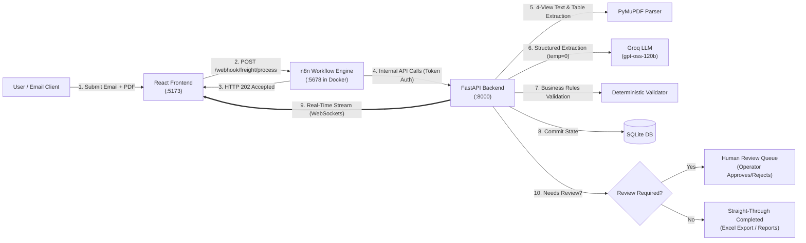

# FreightFlow AI — Intelligent Freight Email & Shipping Document Automation

> **Portfolio Demonstration Project** | AI-Assisted Logistics & Freight-Forwarding Operations Workflow  
> **Core Stack:** React + TypeScript · n8n (Docker) · FastAPI (Python) · PyMuPDF · Groq (`openai/gpt-oss-120b`) · SQLite · WebSockets

---

## 1. Project Objective

Freight forwarding and logistics operations desks receive hundreds of daily emails containing unstructured shipment requests and multi-column PDF attachments (Bills of Lading, Sea Waybills, Booking Confirmations, Commercial Invoices, and Packing Lists). Manually triaging each email, reading complex PDF grids, keying shipment fields into internal spreadsheets/systems, and chasing missing information consumes significant operational time and introduces manual data-entry errors.

**FreightFlow AI** automates the repetitive first stage of freight operations while enforcing strict **human-in-the-loop (HITL)** safety controls:

1. **Ingest:** Accepts freight emails and optional PDF shipping documents (`multipart/form-data` or JSON) through **n8n** webhooks.
2. **Multi-View PDF Extraction:** Extracts layout-preserving text from digital PDFs using a 4-view **PyMuPDF** pipeline (spatial `[x,y]` coordinate blocks, reading-order layout text, Markdown tables via `find_tables()`, and interactive AcroForm fields) while detecting scanned/unreadable documents.
3. **LLM Classification & Structured Extraction:** Uses **Groq (`openai/gpt-oss-120b`)** to classify each request into one of 6 logistics categories (`booking_request`, `tracking_request`, `quotation_request`, `documentation_request`, `complaint`, `other`) and extract 10 schema-validated fields without hallucinating missing data.
4. **Deterministic Validation:** Runs Python business rules to check required category fields, ISO container number format (`4 letters + 7 digits`), ISO dates (`YYYY-MM-DD`), route consistency, and document readability.
5. **Human-in-the-Loop Review Queue:** Routes incomplete, ambiguous, or high-risk (`complaint` / `other` / unreadable PDF) records to an interactive review queue where an operator can inspect flag reasons, edit fields, and **Approve** or **Reject** with audit notes.
6. **Real-Time Observability & Reporting:** Streams live stage-by-stage progress over **FastAPI WebSockets** to the React operations dashboard and exports filtered multi-tab **Excel (`.xlsx`)** operational reports.

> **Safety Boundary:** By design, FreightFlow AI never automatically confirms bookings with carriers, quotes freight rates, alters external TMS records, or sends customer-facing replies. All external actions remain under human control.

---

## 2. Project Architecture & End-to-End Flow



---

## 3. Simplified n8n Workflow Architecture

Instead of managing complicated multi-branch code scripts, n8n orchestrates 3 clean, human-readable operational workflows:

```mermaid
flowchart TD
    subgraph W1["1. Process Email Workflow (freight_process_email)"]
        A1["Webhook: Receive Email + PDF"] --> B1["Validate Input & Create Job"]
        B1 --> C1["Return HTTP 202 Accepted immediately"]
        C1 --> D1{"PDF Attached?"}
        D1 -->|"Yes"| E1["Call FastAPI: Extract PDF text"]
        D1 -->|"No"| F1["Skip PDF step"]
        E1 --> G1["Call FastAPI: LLM Extraction & Validation"]
        F1 --> G1
        G1 --> H1{"Needs Review?"}
        H1 -->|"Yes"| I1["Route to Human Review Queue"]
        H1 -->|"No"| J1["Mark Job Completed"]
    end

    subgraph W2["2. Review Decision Workflow (freight_review_decision)"]
        A2["Webhook: Receive Human Decision"] --> B2["Validate Decision (Approve / Reject)"]
        B2 --> C2["Call FastAPI: Save Review & Corrections"]
        C2 --> D2["Return Result to UI"]
    end

    subgraph W3["3. Read Operations Data Workflow (freight_read_operations_data)"]
        A3["Webhooks: GET metrics, records, queue, job, events, export"] --> B3["Call FastAPI Internal Endpoints"]
        B3 --> C3["Return JSON Data or Download Excel .xlsx"]
    end
```



---

## 4. Tool & Technology Stack

| Layer | Technology | Role in FreightFlow AI |
|---|---|---|
| **Frontend UI** | React 19, TypeScript, Vite | Modern SPA with Homepage, Dashboard, Process Email, Review Queue, and Excel Reports |
| **Styling & Icons** | Tailwind CSS v4, Lucide React | Responsive operational styling and interactive status badges |
| **Workflow Engine** | n8n (Docker) | Webhook intake, non-blocking 202 responses, and server orchestration |
| **Backend API** | Python 3.11+, FastAPI, Uvicorn | Internal REST APIs, WebSockets, PDF parsing, and validation logic |
| **LLM Inference** | Groq API (`openai/gpt-oss-120b`) | Zero-temperature classification and structured JSON extraction |
| **PDF Processing** | PyMuPDF (`pymupdf`) | 4-view layout-aware text, table, and AcroForm extraction |
| **Database** | SQLite | Persistent storage for jobs, extracted records, and review decisions |
| **Reporting** | Pandas, OpenPyXL | Generates multi-tab Excel (`.xlsx`) operational exports |

---

## 5. Repository Structure

```text
FreightFlow-AI/
├── backend/
│   ├── app/
│   │   ├── main.py              # FastAPI app & WebSocket endpoints
│   │   ├── config.py            # Environment configuration
│   │   ├── schemas.py           # Pydantic data models
│   │   ├── llm_service.py       # Groq extraction prompt & client
│   │   ├── pdf_parser.py        # 4-view PyMuPDF document extractor
│   │   ├── validator.py         # Deterministic business rules
│   │   ├── job_service.py       # Job processing & review decision logic
│   │   ├── report_service.py    # Excel (.xlsx) report generator
│   │   ├── realtime.py          # WebSocket connection manager
│   │   └── database.py          # SQLite schema & DB connection
│   ├── requirements.txt
│   └── .env.example
├── frontend/
│   ├── src/
│   │   ├── pages/               # HomePage, Dashboard, ProcessEmail, ReviewQueue, Reports
│   │   ├── components/          # Job timeline, extracted fields, submission form
│   │   └── services/n8nClient.ts# n8n HTTP client
│   ├── package.json
│   └── .env.example
├── n8n/
│   └── workflows/               # n8n workflow definitions (JSON)
├── samples/
│   ├── documents/               # Sample digital Bills of Lading and PDFs
│   └── emails/                  # 32 labelled test emails with ground truth
├── docker-compose.yml           # Runs local n8n container
└── README.md
```

---

## 6. How to Set Up and Run the Project

### Prerequisites
- **Python 3.11+** installed
- **Node.js 20+** installed
- **Docker Desktop** installed and running
- **Groq API Key** (from [console.groq.com](https://console.groq.com))

---

### Step 1 — Configure `.env` Files

1. **Backend (`backend/.env`):**
   ```powershell
   Copy-Item backend\.env.example backend\.env
   ```
   Add your `GROQ_API_KEY`:
   ```env
   GROQ_API_KEY=your_actual_groq_api_key_here
   GROQ_MODEL=openai/gpt-oss-120b
   DATABASE_PATH=data/freightflow.db
   INTERNAL_API_TOKEN=dev-internal-token-change-me
   ALLOWED_ORIGINS=http://localhost:5173
   ```

2. **Frontend (`frontend/.env`):**
   ```powershell
   Copy-Item frontend\.env.example frontend\.env
   ```
   Default values:
   ```env
   VITE_N8N_BASE_URL=http://localhost:5678
   VITE_WS_URL=ws://localhost:8000
   ```

---

### Step 2 — Start Docker (n8n)

In your first terminal (project root):

```powershell
# Start n8n container in the background
docker compose up -d

# Check that the container is running
docker ps
```

*(Note: On first startup, n8n imports the workflows from `./n8n/workflows` automatically).*

---

### Step 3 — Start the Backend (FastAPI)

In your second terminal:

```powershell
cd backend
python -m uvicorn app.main:app --reload --host 0.0.0.0 --port 8000
```

- API Docs: `http://localhost:8000/docs`
- Health check: `http://localhost:8000/health`

---

### Step 4 — Start the Frontend (React)

In your third terminal:

```powershell
cd frontend
npm install   # (first time only)
npm run dev
```

Open **`http://localhost:5173`** in your browser:
- **`/`**: Standalone Homepage with overview and workflow pipeline explanation.
- **`/dashboard`**: Live metrics, classification charts, and WebSocket activity feed.
- **`/process`**: Submit freight emails (with 32 sample scenarios dropdown) and PDF attachments.
- **`/review`**: Interactive Human Review Queue to inspect and approve/reject flagged jobs.
- **`/reports`**: Filter records and export multi-sheet Excel reports.

---

## 7. Running Tests

```powershell
# Run backend pytest suite (from project root)
python -m pytest backend -q

# Run frontend tests
cd frontend
npm test
```
